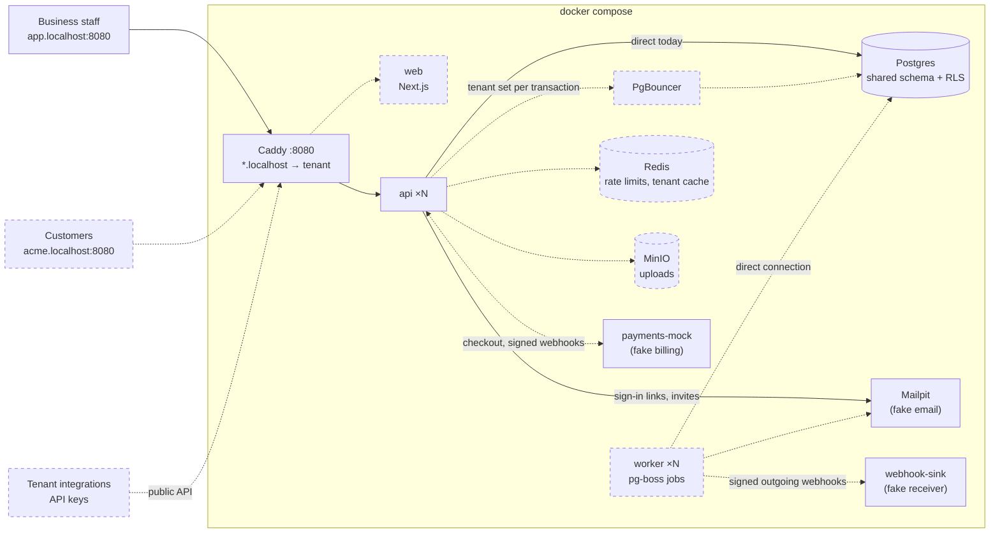

# Multi-tenant SaaS

Appointment booking for small businesses, with isolated tenants, billing, an audit log and a public API.

The step-by-step build plan is in [PLAN.md](PLAN.md).

> **Status:** Phase 2 of 8. Tenant isolation, sign-in, organizations and roles are built and tested. The booking product isn't built yet.

## Run it

```bash
git clone --recurse-submodules https://github.com/gonzalo-gigena/multitenant-saas.git
cd multitenant-saas
cp .env.example .env
docker compose up --watch
```

Open http://localhost:8080 and sign in as `alice@demo.test` / `demo-password` after seeding, or create an account. Needs only Docker with Compose v2. Code changes reload
automatically (Compose Watch). On Windows, clone inside the WSL filesystem, not `/mnt/c`.

Cloned without `--recurse-submodules`? Run `git submodule update --init`.

## Everyday commands

| What | Command |
|---|---|
| Seed demo data | `docker compose run --rm seed` |
| SQL shell | `docker compose exec db psql -U app app` |
| Scale the api | `docker compose up -d --scale api=3` |
| Prove scaling works | `sh common/scripts/smoke.sh 3` |
| Run exactly what CI runs | unit tests (below), `sh infra/test.sh`, then `sh common/scripts/ci-stack.sh 3`. The last two end with `down -v`. |
| Load test at 1, 2, 4 replicas | `sh common/scripts/scale.sh` |
| Metrics (Prometheus) | `docker compose --profile observability up -d`, then http://localhost:9090 |
| RLS guard, tenant isolation suite, role matrix | `sh infra/test.sh` |
| Lint migrations (lock rules) | `sh common/scripts/check-migrations.sh` |
| Read sign-in links and invites | http://localhost:8025 (Mailpit) |
| Unit tests | `docker run --rm -v "$PWD/apps/api:/app" -w /app node:26.13-bookworm-slim node --test` |
| New migration | add `infra/db/migrations/00000N_name.up.sql` + `.down.sql`, restart |
| Update shared code | `git submodule update --remote common` |
| Reset everything | `docker compose down -v` |

## Sign-in, organizations, roles

- **Sign up / sign in** with email + password (argon2id, from `node:crypto`), or with a magic link sent by email.
  The first magic-link sign-in creates the account.
- **Sessions** are a random token in an `HttpOnly; SameSite=Lax` cookie (`Secure` when `APP_URL` is https).
  Postgres keeps only the token's SHA-256, so any api replica can check it and logout ends it everywhere.
- **CSRF:** every mutation needs `x-csrf-token` (an HMAC of the session, returned by sign-in and `GET /api/me`),
  and a request whose `Origin` isn't this host gets a 403. That also covers sign-in, which has no session yet.
- **Organizations:** a user can belong to several tenants. `GET /api/me` lists them with the user's role there,
  and the dashboard's switcher moves between `/t/<slug>` paths. `POST /api/tenants` creates one, with the caller as owner.
- **Invites** are emailed links that sign `(tenant, invite id)`. The invite row expires after 7 days, is deleted on
  use or revoke, and only works for the invited email. Invites make admins or staff, never owners.

Tenant routes live under `/api/t/<slug>`: `services`, `appointments`, `members` and `invites`.

```bash
curl -c jar -H 'content-type: application/json' -d '{"email":"alice@demo.test","password":"demo-password"}' localhost:8080/api/auth/login
curl -b jar localhost:8080/api/t/demo/services
```

The same cookie on `/api/t/acme/services` returns 404, exactly like a tenant that doesn't exist.

### Roles

Every tenant route names one `(action, resource)` pair, and the server calls `can(member, action, resource)`
before the handler runs. Members get 403, non-members 404. This table is checked against
[`permissions.js`](apps/api/src/permissions.js) by `integration/roles.js`, which also calls every route as every
role, so each cell is tested.

| Resource | Action | owner | admin | staff |
|---|---|---|---|---|
| `services` | `read` | ✅ | ✅ | ✅ |
| `services` | `write` | ✅ | ✅ | — |
| `appointments` | `read` | ✅ | ✅ | ✅ |
| `appointments` | `write` | ✅ | ✅ | ✅ |
| `members` | `read` | ✅ | ✅ | ✅ |
| `members` | `manage` | ✅ | — | — |
| `invites` | `read` | ✅ | ✅ | — |
| `invites` | `write` | ✅ | ✅ | — |

`write` is create and delete. `members manage` changes a role or removes a member, but never an owner,
so every tenant keeps at least one.

### How isolation works

- The api connects as `app_user`: no superuser, no `BYPASSRLS`, no grants on `tenants` or `users`, and only `INSERT` on `sessions`.
  Migrations and the seed run as `POSTGRES_USER`, which owns the tables.
- Lookups before a tenant is known (sign-in, the session, a user's tenants, creating a tenant) go through small
  `SECURITY DEFINER` functions that return only what the caller needs.
- Every tenant request is one transaction. It starts by setting `app.tenant_id` from a membership lookup
  (`member_tenant_id`). The lookup finds nothing for non-members, so they get a 404.
  `memberships` and `invites` are tenant tables under RLS like the rest.
- Foreign keys between tenant tables include `tenant_id`, because FK checks skip RLS.
- RLS protects against buggy queries, not against SQL injection: anything that can run SQL as `app_user`
  can set `app.tenant_id` itself. Queries must stay parameterized.

Have a database volume from before Phase 1? `app_user`'s password is only set when the volume is created,
so run `docker compose down -v`, or set it by hand: `ALTER ROLE app_user PASSWORD '...'`.

## Fakes (from common)

These start in dev and CI (`COMPOSE_PROFILES=fakes`), never in production.
Full reference: [`common/README.md`](common/README.md).

| Service | What |
|---|---|
| `payments-mock` | Fake payment provider. Checkout pages at http://localhost:8090. The api calls `http://payments-mock:8090`, and webhooks go to `PAYMENTS_WEBHOOK_URL`. |
| `mailpit` | Catches all email. Send to `smtp://mailpit:1025`, read at http://localhost:8025. |
| `webhook-sink` | Records webhooks sent to `http://webhook-sink:8091/hooks/<name>`. View at http://localhost:8091. |

## Architecture



Solid boxes and arrows run today. Dashed ones are planned in [PLAN.md](PLAN.md).

All tenants share one schema. Postgres Row-Level Security filters every query by the tenant set at the start of the transaction, so a forgotten `WHERE tenant_id` in app code can't leak data.

## Stack

- **api:** Node 26 (`node:http` + `pg`), plain JavaScript. Stateless, so it scales with `--scale api=N`.
- **Caddy:** the only service with a host port. It load-balances `/api/*` across every
  replica (`import lb api 8080`, from common) and serves `apps/web`.
- **Postgres 18:** migrations run once before the api starts (`golang-migrate`).
- **common/:** git submodule with the shared fakes, scripts, Caddy snippet and Prometheus.
  See [portfolio-common](common/README.md).

## Deploy (one VM)

```bash
docker compose -f compose.yaml -f compose.prod.yaml up -d
```

The server's `.env` needs `SITE_ADDRESS`, `IMAGE_REPO`, `TAG`, strong values for `POSTGRES_PASSWORD`,
`APP_DB_PASSWORD` and `SESSION_SECRET`, `APP_URL=https://yourdomain.com`, an `SMTP_URL` relay, and no
`fakes` profile. Sign-in has no rate limit until Phase 6, so put one in front (or wait) before going public. Caddy gets TLS automatically. CI pushes multi-arch images to GHCR on every merge to `main`.

## Decisions & tradeoffs

| Decision | Chosen | Rejected | Why, and what it costs |
|---|---|---|---|
| Tenant isolation | Shared schema with Row-Level Security (`FORCE`, policies on `app.tenant_id`) | Schema per tenant, database per tenant | One migration path and one connection pool for every tenant, and the database enforces isolation instead of every query remembering a `WHERE`. Cost: a small cost per query (to be measured with `EXPLAIN ANALYZE`), and tenants share resources. A large tenant can still move to its own database through a tenant → connection-string table. |
| Setting the tenant | `set_config('app.tenant_id', $1, true)` at the start of each transaction. The app connects as a role without `BYPASSRLS` | A session-level `SET`, or connecting as the table owner | A transaction-local setting is safe with PgBouncer transaction pooling. With no tenant set, `NULLIF` makes every policy return no rows instead of raising an error. |
| References between tenant tables | Composite keys: `PRIMARY KEY (tenant_id, id)`, FKs on `(tenant_id, service_id)` | Plain FKs on `id` | FK checks skip RLS, so a plain FK would accept another tenant's ID and confirm that it exists. Cost: wider keys. |
| Lookups before a tenant is known | No grants on `tenants` or `users`, `INSERT` only on `sessions`. Small `SECURITY DEFINER` functions (sign-in, session, a user's tenants) | Leaving those tables readable by the api | A bad query can't list every customer, user or session. Cost: each new pre-tenant lookup needs a function. `memberships` became an RLS tenant table in Phase 2, since members are managed inside a tenant. |
| Passwords | argon2id at OWASP's minimum (19 MiB, 2 passes), stdlib `crypto.argon2`, PHC strings | bcrypt, an npm argon2 binding | No native dependency. PHC strings carry their parameters, so the cost can rise without breaking old hashes. Cost: about 250 ms of CPU per sign-in on a laptop's Docker VM, which is also what slows guessing. Unknown emails are checked against a dummy hash, so they take as long as a wrong password. |
| Sessions | Random token in an `HttpOnly; SameSite=Lax` cookie, SHA-256 stored in Postgres, 14 days | Signed stateless cookies (JWT) | Logout and removal take effect at once, on every replica, and a leaked table opens no sessions. Cost: one query per request. |
| CSRF | A per-session HMAC token in `x-csrf-token` on every mutation, plus an `Origin` check | `SameSite=Lax` alone | Lax stops cross-site POSTs, but every tenant's booking page is a same-site subdomain, and Lax doesn't help sign-in (no session yet). The token needs no storage: it's derived from the session. |
| Roles | One `can(member, action, resource)` over a static matrix. Every route declares its pair, and the test calls every route as every role | Checks inside each handler, a policy engine | One table to read and one place to change. A route can't skip the check, because the router calls it. Cost: no per-row rules yet (staff seeing only their own bookings comes with Phase 3's staff). |
| Invites | Emailed link signing `(tenant, invite id)`. The row holds the email, role and expiry, and accepting deletes it | A stateless signed token with an expiry inside | The row makes a link single-use and revocable, so a removed member can't rejoin with their old link. Accepting needs the invited email's account. |
| Magic links | Signed `(email, expiry)`, 15 minutes, usable until it expires | Single-use links stored in a table | Mail scanners prefetch links and would burn a single-use one. Anyone who can read the inbox could request a new link anyway. Links are built from `APP_URL`, never the `Host` header, so a spoofed host can't steal them. |
| Catching leaks | A CI test fails if any table with a `tenant_id` column lacks RLS and `FORCE`, and an isolation suite calls every route as tenant B with tenant A's IDs | Relying on code review | A new table without a policy is the most likely leak, and it's cheap to detect automatically. |
| Double booking a staff member | Exclusion constraint `EXCLUDE USING gist (staff_id WITH =, tstzrange(starts_at, ends_at) WITH &&)` | Check, then insert, in app code | Two simultaneous requests can both pass an app-level check. The constraint can't be raced. |
| Background jobs | pg-boss on Postgres | A Redis queue (BullMQ) | No extra service, and a job can be enqueued in the same transaction as the booking. Jobs carry `tenant_id` and set it the same way requests do. |
| Billing | Webhooks → `subscriptions` → computed `entitlements`, enforced in the API | Hiding buttons in the UI | Limits must hold for API clients too. A failed payment leads to a grace period, then read-only mode, and data is never deleted. |
| Audit log | Append-only table written in the same transaction as the change. `app_user` gets only `INSERT` and `SELECT` | Log files or async events | It can't miss a change, and the app can't edit history. |
| Outgoing webhooks | HMAC-signed and retried by the worker. Resolve the hostname once, reject private ranges, then connect to that exact IP | Fetching the tenant's URL directly | A tenant-supplied URL is an SSRF vector, and resolving twice lets DNS rebinding through. |
| Routing | Dashboard on `app.localhost` with the tenant in the path. Subdomains only for public booking pages | A subdomain per tenant for the dashboard too | The session cookie stays on one host. Browsers resolve `*.localhost` without editing `/etc/hosts`. |
| Load balancing | Caddy `dynamic a` upstreams (the `lb` snippet in `common/`) | `reverse_proxy api:8080`, Traefik | Caddy re-reads Docker DNS every 5 s, so `--scale api=N` needs no config change and no Docker socket mount. A plain `reverse_proxy api:8080` is a single upstream to Caddy and doesn't reliably spread load. |
| Migrations | A one-shot `migrate` service that finishes before the api starts | Each replica migrating on boot | Replicas starting together would race on the same migration. |

Rows for parts that aren't built yet record the plan's choice. Each one gets confirmed or revised when that phase is built.

## Scaling

### Measured

The skeleton only, not the product yet: k6 with 20 virtual users for 20 s against `GET /api/hello`, which reads one row from Postgres through Caddy. Run on an Apple M1 laptop with 8 CPUs and 8 GB given to Docker, with the dev override left out:

```bash
COMPOSE_FILE=compose.yaml sh common/scripts/scale.sh
```

| api replicas | req/s | p95 latency | failed |
|---|---|---|---|
| 1 | 12,317 | 3.14 ms | 0.00% |
| 2 | 10,721 | 3.76 ms | 0.00% |
| 4 | 11,059 | 3.68 ms | 0.00% |

4 replicas served 0.9× the requests of 1. At 1 replica the api used about one core, while Caddy, Postgres and k6 together used about four of the laptop's eight (sampled with `docker stats` during the run). The api isn't the bottleneck on one machine, so more replicas only compete for the same CPUs. Replicas pay off when the api is the busiest process, and a hello endpoint doing one query isn't.

### How each part scales

| Part | Scales by | Limit |
|---|---|---|
| `api` | `--scale api=N` (stateless) | Postgres connections. Add PgBouncer past ~2 replicas. |
| `worker` | `--scale worker=N` | pg-boss claims jobs with `SKIP LOCKED`, so workers don't block each other |
| Postgres | One primary | Every tenant shares it, plus the RLS cost on every query |
| Redis | One instance | Rate limits and the tenant config cache |

### Where it breaks next

- **Postgres connections.** PgBouncer in transaction mode once there are more than ~2 api replicas. pg-boss keeps its own direct connection.
- **One noisy tenant.** Per-tenant rate limits first. Then move that tenant to its own database through a tenant → connection-string routing table.
- **Tenant config read on every request** (plan, timezone, branding). Cache it in Redis and invalidate on change.

Phase 8 adds the real test: `--scale api=3 --scale worker=2` with k6 driving 200 tenants of booking traffic, plus the RLS cost from `EXPLAIN ANALYZE` with and without policies.
